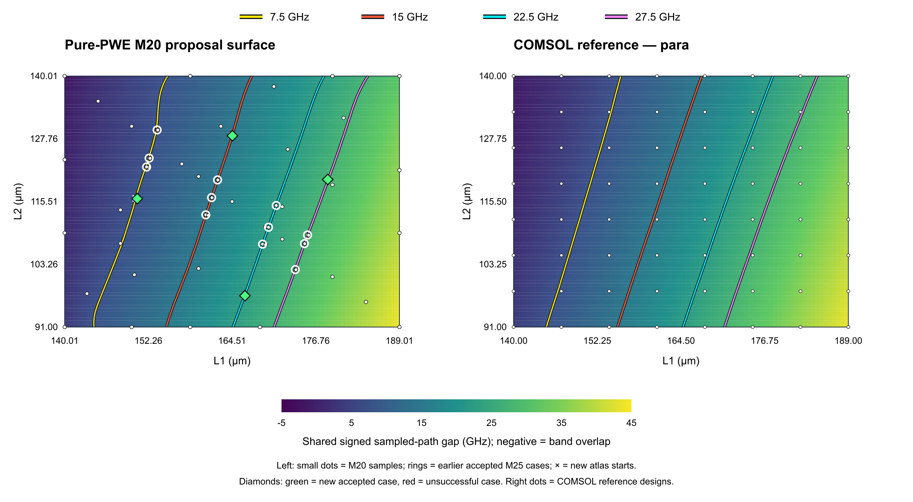

# Pure-PWE electromagnetic forward and inverse design

Compute electromagnetic band diagrams and find geometric lengths **L1, L2**
for a requested signed path gap using plane-wave-expansion physics.
**No ML training, learned surrogate, fitted residual, or scikit-learn is used.**

The geometry is a fixed family of two clipped triangular air inclusions in a
dielectric hexagonal cell. This is parameter-based inverse design, not arbitrary
topology optimization. Current physics-backed validation concerns `para`;
`r1` physical provenance remains unresolved.

## Start here

- [Forward/inverse equations and algorithms](docs/FORWARD_AND_INVERSE_DESIGN.md)
- [Installation and reproduction](docs/REPRODUCIBILITY.md)
- [Results generated from saved JSON](docs/RESULTS_SNAPSHOT.md)
- [Cleanup, tests and publication status](docs/REPOSITORY_PREPARATION.md)
- [Final independent audit](results/pure_pwe_atlas_validation_v1/final/VALIDATION_REPORT.md)
- [Interactive contour map](results/pure_pwe_atlas_validation_v1/final/validated_response_atlas.html)



## Algorithms retained

| Component | Role |
|---|---|
| Interface-energy PWE | Material Fourier matrices and electromagnetic eigenproblems |
| Fixed radial-projector quadrature | Geometry-aware integration and smooth analytic sensitivities |
| Saved-PWE bracket/secant inverse | Find a response using saved spectra and fresh candidate evaluations |
| Bounded trust-region inverse | Analytic-gradient steps with fresh PWE acceptance and polling fallback |
| Adaptive response atlas | Interpolate PWE samples to propose useful starts; no ML training |
| Independent refinement and audits | Check unchanged candidates at M25 after M20 search; replay evidence |

The atlas uses deterministic SciPy RBF interpolation. It is a numerical proposal
map, not a trained ML model or a replacement for physics acceptance.
COMSOL data is retained only as a separate reference for validation.

## Install and test

From the repository root, with a supported Python installation:

```powershell
python -m venv .venv
.\.venv\Scripts\Activate.ps1
python -m pip install -e ".[test]"
python -m pytest tests/ -v
```

On Linux/macOS, activate with `source .venv/bin/activate`.
Dependencies are NumPy, SciPy, PyTorch and PyYAML; pytest is a test extra.
PyTorch supports numerical eigensolves/device execution, not neural-network
training here. CPU is supported; CUDA is optional.
`requirements.lock` records direct review versions, not a universal full lock.
See the reproduction guide for threading settings and environment limitations.

The entire `tests/` directory is now the maintained physics suite, not a
filtered subset of the retired ML suite. See the preparation notes for the
actual result of the current publication check.

## Use

Read saved results without launching simulations, or regenerate their summary:

```powershell
python scripts/build_repository_snapshot.py --check
```

For the saved-library inverse route:

```powershell
python scripts/inverse_pwe.py 20 --device cpu
```

This may run expensive calculations and writes to its configured result
directory. Read [the saved-PWE guide](docs/pure_pwe_inverse.md) first; use an
isolated working copy when repeating published targets. For anchor-free and
atlas experiments, follow the gated launcher instructions in the reproduction
guide. Do not overwrite frozen experiments.

## What the results mean

`gap = min_k f2 - max_k f1` is signed; negative means overlapping bands.
A contour is a proposal, not a validated family of designs. M20/M25 agreement
is an empirical refinement check, not continuum or full-zone certification.
Reported timings distinguish fast start selection from expensive fresh physics.
Different PWE formulations have separate validation evidence.

## Layout

```text
configs/           Geometry, frozen experiment controls and criteria
data/processed/    bands.npz reference data
src/invdes/        PWE, sensitivities, metrics and inverse algorithms
scripts/           Physics launchers, verification and report generators
tests/             Complete maintained physics-only test suite
results/           Scientific evidence, checkpoints and generated reports
docs/              Current guides
```

